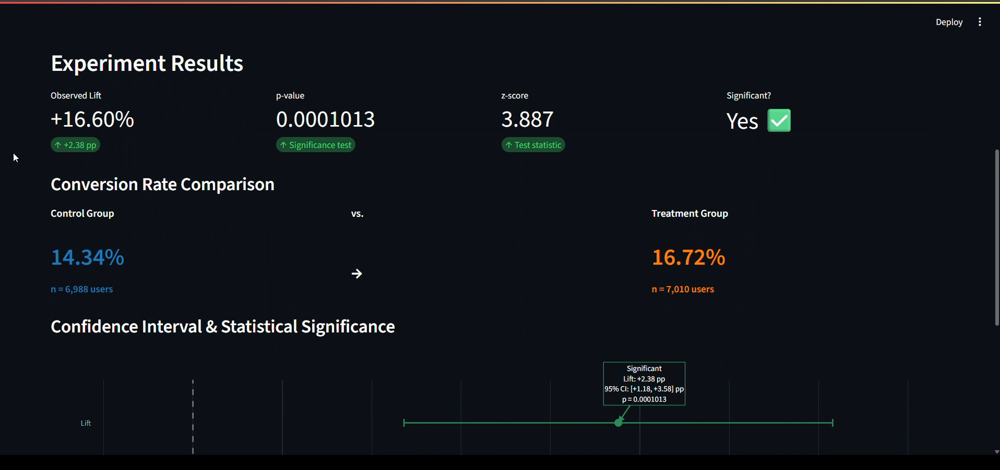
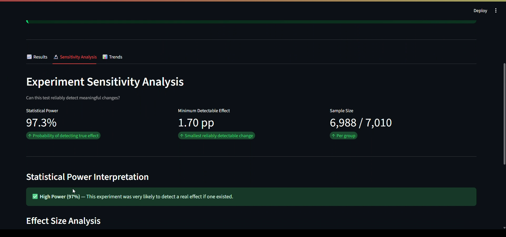
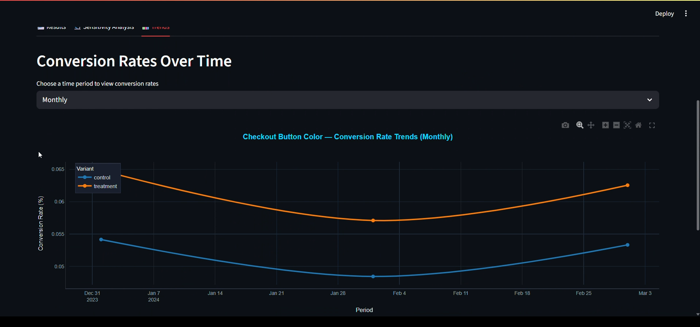

# A/B Testing Analysis Framework

A comprehensive Streamlit-based dashboard for running, analyzing, and visualizing A/B test results with rigorous statistical testing and interactive visualizations.


## 🎯 Overview

This framework helps data analysts and product managers make data-driven decisions by providing:
- Statistical rigor for A/B test analysis (two-proportion z-tests)
- Interactive dashboards for exploring experiment results
- Power analysis and sample size calculations
- Automated experiment tracking with SQLite database
- Visual insights into test performance across multiple experiments

**Built for:** E-commerce teams, product managers, and data analysts running conversion optimization experiments.

Current benchmark: 713,509 sessions across 10 A/B experiments. The framework greenlit 2 improvements, stopped/reverted 3 harmful variants, held 4 inconclusive tests, and flagged 1 promising experiment requiring more evidence. Power analysis identified severely underpowered tests requiring up to 1,121× more users before reliable conclusions could be drawn.

## ✨ Features

- ✅ **Statistical Testing:** Two-proportion z-tests with proper significance testing
- ✅ **Decision Rules:** Separates statistical significance from practical (business) significance using a prespecified practical threshold per experiment
- ✅ **Assignment Validity:** Sample-ratio-mismatch (SRM) and cross-variant assignment checks that block launch decisions when they fail
- ✅ **Power Analysis:** Calculate statistical power for multiple tests
- ✅ **Sample Size Calculator:** Determine required users for desired power
- ✅ **Effect Size Analysis:** Calculate minimum detectable effects
- ✅ **Interactive Dashboard:** Streamlit-based UI with real-time filtering
- ✅ **Multiple Experiments:** Track and compare 10 concurrent A/B experiments
- ✅ **Data Persistence:** SQLite database for experiment history
- ✅ **Rich Visualizations:** Charts and graphs for experiment insights
- ✅ **Synthetic Data:** Includes realistic sample data for testing

## 🚀 Quick Start

### Installation

```bash
# Clone the repository
git clone https://github.com/Rotimi779/AB-Testing.git
cd AB-Testing

# Install dependencies
pip install -r requirements.txt
```

### Refreshing Results and Running the Dashboard

```bash
# (Only needed if the raw CSV files changed) load every CSV in data/ into ab_testing.db
python load_csv_files.py

# Recompute the experiment summary, write data/summary_and_analysis.csv
# and refresh the summary_and_analysis table in ab_testing.db
python refresh_results.py

# Launch the Streamlit app
streamlit run charts.py
```

The app will open in your browser at `http://localhost:8501`.

`refresh_results.py` is the single supported way to update the results the dashboard shows. Importing `statistical_tests.py` does not run any analysis or write any files. If the dashboard is already running when you refresh, restart it (or clear its cache) to pick up the new results.

### Running the Tests

```bash
pip install -r requirements.txt   # includes pytest
python -m pytest
```

The tests in `tests/` cover the decision rules (every decision state and the boundary conventions) and the SRM / assignment-integrity checks.

## 📊 Dataset Description

The project includes synthetic A/B test data and configuration across 7 CSV files:

### 1. `experiments.csv`
Tracks experiment metadata:
```csv
experiment_id, experiment_name, start_date, end_date, hypothesis, metric_type
1, checkout_button_color, 2024-01-01, 2024-03-31, Green button will increase conversions vs blue button, conversion
```

**Current Experiments:**
- Checkout Button Color
- Pricing Display
- Email Subject Line
- Product Page Layout
- Free Shipping Threshold
- Search Result Sorting
- Checkout Form Fields
- Recommendation Algorithm
- Cart Discount Display
- Mobile App Onboarding

### 2. `user_sessions.csv`
Detailed session-level data (713,509 sessions across 10 experiments):
```csv
session_id, user_id, experiment_id, session_date, variant, page_views, time_on_site, clicked_cta, converted, revenue
1, 1, 1, 2024-02-18, treatment, 8, 350, True, False, 0.0
```

**Metrics tracked:**
- Page views per session
- Time on site (seconds)
- CTA clicks (boolean)
- Conversion (boolean)
- Revenue per session

### 3. `users.csv`
User demographic data (20,053 synthetic users.)

### 4. `experiment_assignments.csv`
User-to-experiment variant mapping. This is the authoritative source for the SRM and cross-variant assignment checks.

### 5. `daily_metrics.csv`
Aggregated daily performance metrics

### 6. `experiment_policy.csv`
The decision policy for each experiment, kept separate from the experiment description:
```csv
experiment_id,practical_threshold_pp,alpha,expected_treatment_share,srm_alpha,threshold_basis
1,0.5,0.05,0.5,0.001,"Low-cost UI tweak: 3% relative lift on a 14.3% baseline (0.43 pp), rounded to 0.25 pp"
```

| Column | Meaning |
|---|---|
| `practical_threshold_pp` | Smallest improvement, in percentage points, worth shipping. Must be chosen **before** looking at final results. Blank means not configured. |
| `alpha` | Significance level for the confirmatory experiment decision pipeline. This pipeline currently supports only `0.05` because its reported outcome confidence interval is fixed at 95%. The standalone power, sample-size, and MDE planning calculators support configurable alpha values. |   
| `expected_treatment_share` | Planned share of users assigned to treatment (the demo experiments were designed as 50/50). |
| `srm_alpha` | Threshold for the SRM check, deliberately stricter than `alpha` (default `0.001`). |
| `threshold_basis` | Free-text rationale for the threshold (documentation only, not used in calculations). |

#### Demo threshold policy

The demo experiments are synthetic, so no real business owner exists to set thresholds. They use **illustrative demo values** derived from one fixed rule that depends only on the cost of the change and the baseline conversion rate, never on the observed effect, CI, p-value or MDE:

```text
practical_threshold_pp = baseline rate × minimum worthwhile relative lift, rounded to the nearest 0.25 pp
```

| Cost tier | Minimum worthwhile relative lift | Experiments |
|---|---|---|
| Low (cheap, reversible UI, copy or configuration change) | 3% | button color, email subject line, search sorting, checkout form fields |
| Medium (redesign work, or some margin or brand impact) | 5% | pricing display, product page layout, cart discount display, mobile onboarding |
| High (ongoing margin cost, or new infrastructure to maintain) | 8% | free shipping threshold, recommendation algorithm |

The relative-lift tiers reflect public experimentation guidance. Most ideas fail or move metrics only a little, and winning e-commerce tests are typically a few percent of relative lift (Kohavi, Tang & Xu, *Trustworthy Online Controlled Experiments*). A change must therefore clear a bigger bar the more it costs to build and run.

**Caveat:** these values were written after the demo data existed, so they are not truly prespecified in the way a real experiment's threshold must be. In a real experiment, the product owner sets the threshold before the experiment ends. Leave `practical_threshold_pp` blank to make the dashboard show `CONFIG REQUIRED / NO PRACTICAL DECISION` instead. After any change to this file, run `python refresh_results.py`.

### 7. `summary_and_analysis.csv`
Experiment summaries generated by `python refresh_results.py`. Key columns:

| Column | Unit / meaning |
|---|---|
| `difference_pp`, `lower_ci_pp`, `upper_ci_pp` | Treatment minus control and its 95% CI, in percentage points |
| `lower_ci`, `upper_ci` | The same CI as proportions (0.015 = 1.5 pp) |
| `p_value`, `alpha`, `statistically_significant` | Two-sided z-test p-value, and whether `p_value <= alpha` |
| `practical_threshold_pp` | Copied from the policy file (blank if not configured) |
| `estimate_meets_practical_threshold`, `ci_clears_practical_threshold` | Point estimate ≥ threshold, and lower CI bound ≥ threshold |
| `decision`, `decision_reason`, `summary`, `recommendation` | Canonical decision state and explanatory text |
| `validity_status`, `validity_reason`, `srm_p_value`, `srm_pass`, `cross_variant_users` | Assignment validity checks |
| `power`, `mde_pp`, `mde_relative_lift_pct`, `mde_exceeds_practical_threshold` | Sensitivity quantities (MDE at 80% power) |

## 🧮 Statistical Functions

All functions live in `statistical_tests.py`, which is safe to import. The examples below run as written and show their real output. Values ending in `_pp` are percentage points. `difference`, `lower_ci` and `upper_ci` returned by the z-test are proportions.

### 1. Two-Proportion Z-Test

`two_proportion_ztest(n1, x1, n2, x2)` takes control users, control conversions, treatment users and treatment conversions. It uses the pooled standard error for the test and the unpooled standard error for the 95% CI.

```python
from statistical_tests import two_proportion_ztest

# Example: 5.00% vs 5.75% conversion with 10,000 users per group
result = two_proportion_ztest(10000, 500, 10000, 575)

print(f"z-score: {result['z_score']:.3f}")
print(f"P-value: {result['p_value']:.4f}")
print(f"Difference: {result['difference'] * 100:+.2f} pp")
print(f"95% CI: [{result['lower_ci'] * 100:.2f}, {result['upper_ci'] * 100:.2f}] pp")
print(f"Relative lift: {result['lift_percent']}%")
```

**Output:**
```
z-score: 2.352
P-value: 0.0187
Difference: +0.75 pp
95% CI: [0.12, 1.38] pp
Relative lift: 15.0%
```

### 2. Power, Sample Size and MDE

These three functions take a one-row DataFrame with `control_rate`, `treatment_rate`, `control_size`, `treatment_size` (and `lift_percent` for the MDE function). All tests are two-sided. They accept optional keyword arguments, and the defaults reproduce the standard settings:

| Function | Signature |
|---|---|
| Power | `calculate_statistical_power_from_results(summary_df, alpha=0.05)` |
| Sample size | `calculate_sample_users_from_results(summary_df, alpha=0.05, power=0.80)` |
| MDE | `calculate_minimum_detectable_effect_from_results(summary_df, alpha=0.05, power=0.80)` |

The Power Calculator tab passes its α and desired-power sliders through these arguments.

```python
import pandas as pd
from statistical_tests import (
    calculate_statistical_power_from_results,
    calculate_sample_users_from_results,
    calculate_minimum_detectable_effect_from_results,
)

summary = pd.DataFrame({
    "control_rate": [0.05],
    "treatment_rate": [0.0575],
    "control_size": [10000],
    "treatment_size": [10000],
    "lift_percent": [15.0],
})

# Power to detect a 5.00% -> 5.75% difference with these group sizes
power = calculate_statistical_power_from_results(summary)  # returns a length-1 array
print(f"Statistical power: {float(power[0]):.1%}")

# Users needed for 80% power to detect that difference
required_users, total_required, multiplier = calculate_sample_users_from_results(summary)
print(f"Users needed per group: {required_users:,}")
print(f"Total users needed: {total_required:,}")

# Smallest difference detectable at 80% power with these group sizes and baseline
mde = calculate_minimum_detectable_effect_from_results(summary)
print(f"MDE: {mde['mde_pp']:.2f} pp ({mde['mde_relative_lift_pct']:.1f}% relative)")
```

**Output:**
```
Statistical power: 65.3%
Users needed per group: 14,177
Total users needed: 28,354
MDE: 0.90 pp (18.0% relative)
```

**Interpretation:** 65.3% power means that if the true difference were exactly 0.75 pp, this design would reach significance about 65% of the time.

Stricter settings need more data. For the same example, α = 0.01 and 90% power give:

```python
required_users, _, _ = calculate_sample_users_from_results(summary, alpha=0.01, power=0.90)
mde = calculate_minimum_detectable_effect_from_results(summary, alpha=0.01, power=0.90)
print(f"Users needed per group: {required_users:,}")
print(f"MDE: {mde['mde_pp']:.2f} pp")
```

**Output:**
```
Users needed per group: 26,876
MDE: 1.26 pp
```

### 3. Decision Rule

`classify_experiment_decision(...)` is a pure function. It takes the observed effect and CI in percentage points, the p-value, and the prespecified practical threshold.

```python
from statistical_tests import classify_experiment_decision

result = classify_experiment_decision(
    effect_pp=2.5,
    lower_ci_pp=0.8,
    upper_ci_pp=4.2,
    p_value=0.01,
    practical_threshold_pp=1.5,   # example value only
    alpha=0.05,
    experiment_valid=True,
)
print(result["decision"])
print(result["decision_reason"])
```

**Output:**
```
PROMISING / NEED MORE EVIDENCE
The point estimate meets the practical threshold but the lower CI bound does not, so practical value is not established.
```

The result also contains `statistically_significant`, `positive_significant`, `negative_significant`, `estimate_meets_practical_threshold`, `ci_clears_practical_threshold` and `practical_value_still_plausible`. Pass `practical_threshold_pp=None` when no threshold is configured. The decision is then `CONFIG REQUIRED / NO PRACTICAL DECISION`.

### 4. Sample Ratio Mismatch (SRM)

```python
from statistical_tests import check_sample_ratio_mismatch

srm = check_sample_ratio_mismatch(6891, 7204, expected_treatment_share=0.5, srm_alpha=0.001)
print(f"SRM p-value: {srm['srm_p_value']:.4f}, pass: {srm['srm_pass']}")
```

**Output:**
```
SRM p-value: 0.0084, pass: True
```

`summarize_assignments(assignments_df)` counts unique assigned users per variant and the number of users assigned to both variants of the same experiment.

## 🧭 Decision Methodology

The dashboard answers these questions in order:

```text
Was the experiment valid?
        ↓
What effect did we observe?
        ↓
How uncertain is that estimate?
        ↓
Is there statistical evidence of a real effect?
        ↓
Does the effect meet the prespecified practical threshold?
        ↓
GREENLIGHT / PROMISING / LOW IMPACT / INCONCLUSIVE / STOP
```

**p < 0.05 does not automatically mean SHIP.**

### Key Concepts

- **Statistical significance.** The two-sided p-value is at or below α (0.05). It says the data are hard to explain with zero effect. It says nothing about whether the effect is big enough to matter.
- **Practical significance.** Whether the effect is large enough to be worth acting on, judged against the practical threshold.
- **Practical threshold (δ, `practical_threshold_pp`).** The smallest positive improvement the business considers worth shipping. It is set per experiment in `data/experiment_policy.csv`, before looking at final results. It is never inferred from the observed lift, the CI, the p-value or the MDE.
- **Confidence interval.** The 95% CI `[L, U]` describes the uncertainty around the observed effect. Decisions use only its endpoints: does it lie entirely above 0, entirely below 0, entirely above δ, or entirely below δ? The share of the interval above a line is **not** a probability and is never used.
- **MDE (minimum detectable effect).** The smallest effect the study is designed to detect at a chosen significance level and target power, given the sample sizes and baseline rate. The dashboard's default planning settings are α = 0.05 and 80% power, but the planning calculator supports configurable values.
- **Power.** The probability that the test reaches significance if a given true effect exists. It is useful for planning, at an effect size chosen in advance. The Sensitivity tab also reports **power at the observed effect size**. That number is computed from the observed effect, so it moves with the p-value: significant results always look well powered and non-significant ones always look underpowered. It is not independent evidence that an experiment was reliable. To judge sensitivity, compare the MDE with the practical threshold instead.
- **SRM (sample ratio mismatch).** A chi-square goodness-of-fit test of assigned users against the planned split, computed from `experiment_assignments.csv`. It uses its own threshold (`srm_alpha`, default 0.001), stricter than α, because it is a data-quality alarm. The validity check also fails if any user is assigned to both variants of the same experiment. A failed check makes the decision `INVALID / NO DECISION`, and you should investigate randomization and assignment instrumentation before interpreting the effect.
- **Optional stopping.** Standard p-values in this project assume a prespecified/fixed analysis plan. Repeatedly peeking and stopping when significance first appears can inflate Type I error. If continuous monitoring with arbitrary stopping is required, use a sequential testing design rather than this fixed-horizon decision rule. This project does not implement sequential testing.
- **Multiple testing.** Each experiment has one prespecified primary metric, so no correction is applied. Separate experiments do not need a correction unless you make one joint claim across them. If secondary metrics, segments or extra variants are later tested as one family, apply a documented correction (preferably Holm) or label those analyses exploratory. Unadjusted secondary or segment results with p < 0.05 are not confirmatory. **No multiple-testing correction is implemented in this version.**
- **Guardrails.** Production experiments often pair the primary metric with prespecified guardrail metrics such as latency, refunds or errors. This project has no authoritative guardrail metrics or thresholds, so **guardrails are not configured or evaluated in this version**.

### Decision States

With δ = `practical_threshold_pp`, L and U the CI bounds in percentage points:

| Decision | Rule | Meaning |
|---|---|---|
| `INVALID / NO DECISION` | Validity check failed (SRM or cross-variant assignment) | Checked first. Do not interpret the effect. |
| `CONFIG REQUIRED / NO PRACTICAL DECISION` | No practical threshold configured | A configuration gap, not a validity failure. Statistics are still shown. |
| `GREENLIGHT` | p ≤ α **and** L ≥ δ | Significant, and even the lower CI bound clears the threshold. |
| `STOP / REVERT` | p ≤ α **and** U < 0 | Credible evidence of harm. |
| `PROMISING / NEED MORE EVIDENCE` | Estimate ≥ δ but L < δ (significant or not), **or** significant positive effect (L > 0) with U ≥ δ | Worthwhile upside is plausible but not established. |
| `LOW IMPACT` | p ≤ α, L > 0 **and** U < δ | A real positive effect, but even the upper CI bound is below the threshold. |
| `INCONCLUSIVE / HOLD` | Everything else, typically p > α with estimate < δ | Not enough evidence. **Not significant does not mean no effect.** A negative but non-significant estimate also lands here, not in STOP. |

**Boundary conventions** (enforced by the tests):

- `p_value == alpha` counts as significant.
- `lower_ci_pp == practical_threshold_pp` counts as clearing the threshold.
- `upper_ci_pp == 0` is **not** an entirely negative CI.
- `lower_ci_pp == 0` is **not** an entirely positive CI.

An inconclusive result never triggers "keep running until significant" advice. More data is only appropriate when the original stopping rule or sample-size plan allows it, or as a new, planned follow-up experiment.

## 📁 Project Structure

```
AB-Testing/
├── charts.py                    # Main Streamlit dashboard
├── statistical_tests.py         # Statistical functions, decision rules, SRM, summary pipeline (import-safe)
├── refresh_results.py           # Recompute results and refresh the SQLite summary table
├── load_csv_files.py            # Load every CSV in data/ into SQLite
├── ab_testing.db                # SQLite database
├── data/
│   ├── experiments.csv          # Experiment metadata
│   ├── experiment_policy.csv    # Per-experiment decision policy (practical threshold, alpha, allocation, SRM alpha)
│   ├── user_sessions.csv        # Session-level data
│   ├── users.csv                # User demographics
│   ├── experiment_assignments.csv
│   ├── daily_metrics.csv        # Aggregated metrics
│   └── summary_and_analysis.csv # Generated by refresh_results.py
├── queries/                     # SQL queries for analysis
├── tests/                       # pytest tests for decision rules and SRM
├── requirements.txt
└── README.md
```

## 🎨 Dashboard Features

### Interactive Filters
- Filter by experiment name
- Date range selection
- Variant comparison (Control vs Treatment)
- Metric type selection

### Visualizations
- Conversion rate comparisons
- Time-series performance trends
- Statistical significance indicators
- Power analysis charts
- Sample size recommendations

### Real-Time Calculations
- Automatic p-value computation
- Live power analysis
- Dynamic sample size estimates
- Effect size visualization

## Dashboard Preview
The screenshots below predate the decision-rule revamp. The current Results tab also shows the practical threshold, decision reason, validity status and SRM result, and the CI plot marks both 0 pp and the practical threshold.





## 📈 Usage Examples

### Example 1: Analyze Existing Experiment

1. Refresh results: `python refresh_results.py`
2. Launch dashboard: `streamlit run charts.py`
3. Select "Checkout Button Color". The Results tab shows:
   - Control conversion: 14.34%, treatment conversion: 16.72%
   - Observed effect: +2.38 pp, 95% CI [1.18, 3.58] pp, p = 0.0001 (statistically significant)
   - Validity: PASS (SRM p = 0.85)
   - Practical threshold: 0.50 pp, and MDE at 80% power: 1.70 pp
   - Decision: `GREENLIGHT`, because the result is significant and even the lower CI bound (1.18 pp) clears the 0.50 pp threshold
   - Planning warning: the MDE is larger than the threshold, so this design could have missed a smaller but still worthwhile effect
4. Select "Free Shipping Threshold" for a contrasting case. It shows +1.34 pp, 95% CI [0.17, 2.51] pp, p = 0.025, against a 1.00 pp threshold. It is significant, but the lower CI bound does not clear the threshold, so the decision is `PROMISING / NEED MORE EVIDENCE`.

### Example 2: Plan New Experiment

```python
import pandas as pd
from statistical_tests import calculate_sample_users_from_results

# How many users do I need to detect 8.0% -> 8.8% (a 10% relative lift) at 80% power?
plan = pd.DataFrame({
    "control_rate": [0.08],
    "treatment_rate": [0.088],
    "control_size": [1],      # group sizes only set the allocation ratio here (1:1)
    "treatment_size": [1],
})
required_users, total_required, _ = calculate_sample_users_from_results(plan)
print(f"Run experiment with {required_users:,} users per variant ({total_required:,} total)")
# Run experiment with 18,862 users per variant (37,724 total)
```

Choose the practical threshold first, then size the experiment so its MDE is at or below that threshold.

### Example 3: Check Test Sensitivity

Compare the design's MDE with the practical threshold. Don't use power at the observed effect, which only restates the p-value.

```python
import pandas as pd

summary = pd.read_csv("data/summary_and_analysis.csv")
row = summary[summary["experiment_name"] == "product_page_layout"].iloc[0]

if row["mde_pp"] > row["practical_threshold_pp"]:
    print(f"MDE {row['mde_pp']:.2f} pp exceeds the {row['practical_threshold_pp']:.2f} pp threshold: "
          "worthwhile effects could have been missed, so a null result is weak evidence of no effect.")
else:
    print("The design could detect the smallest worthwhile effect at 80% power.")
# MDE 1.70 pp exceeds the 0.75 pp threshold: worthwhile effects could have been missed, so a null result is weak evidence of no effect.
```

## 🔧 Requirements

```txt
streamlit>=1.28.0
pandas>=2.0.0
numpy>=1.24.0
scipy>=1.11.0
plotly>=5.16.0
statsmodels>=0.14.0
pytest>=7.0      # tests only
sqlite3 (built-in)
```

## 📊 Statistical Methodology

### Approach
Uses **two-proportion z-tests** for comparing conversion rates between control and treatment groups.

### Assumptions
- Independent samples (no cross-contamination)
- Large sample sizes (n > 30 per group)
- Binary outcomes (converted/not converted)
- Random assignment to variants

### Significance Testing
- Default α = 0.05 (5% significance level)
- Two-tailed test (detects both increases and decreases)
- One prespecified primary metric per experiment; no multiple-testing correction is implemented (see Decision Methodology)
- Launch decisions also require a prespecified practical threshold and a passing validity (SRM) check

### Power Analysis
- Recommended minimum power: 80%
- Accounts for Type II errors (false negatives)
- Supports planning a fixed sample size in advance, which is what makes fixed-horizon p-values valid

## 🎯 Real-World Applications

### E-commerce
- **Button tests:** Color, size, text variations
- **Checkout flow:** Steps, form fields, payment options
- **Product pages:** Layout, images, descriptions

### SaaS
- **Pricing pages:** Tiers, messaging, CTAs
- **Onboarding:** Steps, tutorials, prompts
- **Feature adoption:** UI changes, tooltips, notifications

### Content/Media
- **Headlines:** A/B test article titles
- **Email campaigns:** Subject lines, content, timing
- **Landing pages:** Copy, images, form placement

## ⚠️ Limitations & Considerations

### Current Limitations
- Binary outcomes only (not suitable for continuous metrics like revenue per user)
- Assumes normal distribution (large sample approximation)
- No built-in sequential testing: p-values are only valid for a prespecified, fixed analysis plan
- Single-metric focus (doesn't handle multiple metrics simultaneously); no multiple-testing correction is implemented
- Guardrail metrics are not configured or evaluated
- Practical thresholds for the demo experiments are illustrative values from a documented rule, not real business policy

### When NOT to use this framework
- Very small samples (n < 30 per group)
- Continuous outcome metrics (use t-tests instead)
- Network effects (use cluster randomization)
- Long-term impact measurement (use difference-in-differences)

### Best Practices
✅ **Pre-register** your hypothesis, primary metric, practical threshold and sample size
✅ **Run tests** for full business cycles (avoid weekly seasonality)
✅ **Check power** before declaring "no effect", and remember not significant is not the same as no effect
✅ **Stop at the prespecified sample size or end date**, or use a valid sequential method. Do not stop the first time p < 0.05 appears
✅ **Treat secondary metrics and segments as exploratory** unless a documented correction (for example Holm) is applied
✅ **Check SRM** before interpreting any treatment effect

## 🚀 Future Enhancements

Potential improvements:
- [ ] Bayesian A/B testing option
- [ ] Sequential testing support (proper peeking)
- [ ] Prespecified guardrail metrics and thresholds
- [ ] Multiple-testing correction (for example Holm) for secondary metrics and segments
- [ ] Multi-armed bandit algorithms
- [ ] Continuous metric support (t-tests, Mann-Whitney)
- [ ] Automated experiment monitoring and alerts
- [ ] Integration with analytics platforms (Google Analytics, Mixpanel)
- [ ] Export results to PDF/PowerPoint
- [ ] Multi-variate testing (test multiple changes simultaneously)

## 🤝 Contributing

Contributions welcome! To contribute:

1. Fork the repository
2. Create a feature branch (`git checkout -b feature/amazing-feature`)
3. Commit your changes (`git commit -m 'Add amazing feature'`)
4. Push to the branch (`git push origin feature/amazing-feature`)
5. Open a Pull Request

## 📝 License

This project is licensed under the MIT License - see the LICENSE file for details.

## 👤 Author

**Rotimi** 
- GitHub: [@Rotimi779](https://github.com/Rotimi779)
- LinkedIn: https://www.linkedin.com/in/rotimiajayi/

## 🙏 Acknowledgments

- Statistical methods based on "Trustworthy Online Controlled Experiments" by Ron Kohavi, Diane Tang, and Ya Xu
- Inspired by A/B testing frameworks used at Google, Microsoft, and Netflix
- Built with [Streamlit](https://streamlit.io/) for interactive dashboards

---

## 📖 Additional Resources

**Learn more about A/B testing:**
- [Evan Miller's A/B Testing Guide](https://www.evanmiller.org/ab-testing/)
- [Optimizely Stats Engine](https://www.optimizely.com/optimization-glossary/statistical-significance/)
- [Google's Guide to Experimentation](https://services.google.com/fh/files/misc/exp-design-guide.pdf)

**Academic papers:**
- Kohavi et al. (2009) "Controlled Experiments on the Web: Survey and Practical Guide"
- Deng et al. (2013) "Improving the Sensitivity of Online Controlled Experiments"

---

**Questions or issues?** Please open an issue on GitHub!

**Enjoy the framework?** Give it a ⭐ on GitHub!
